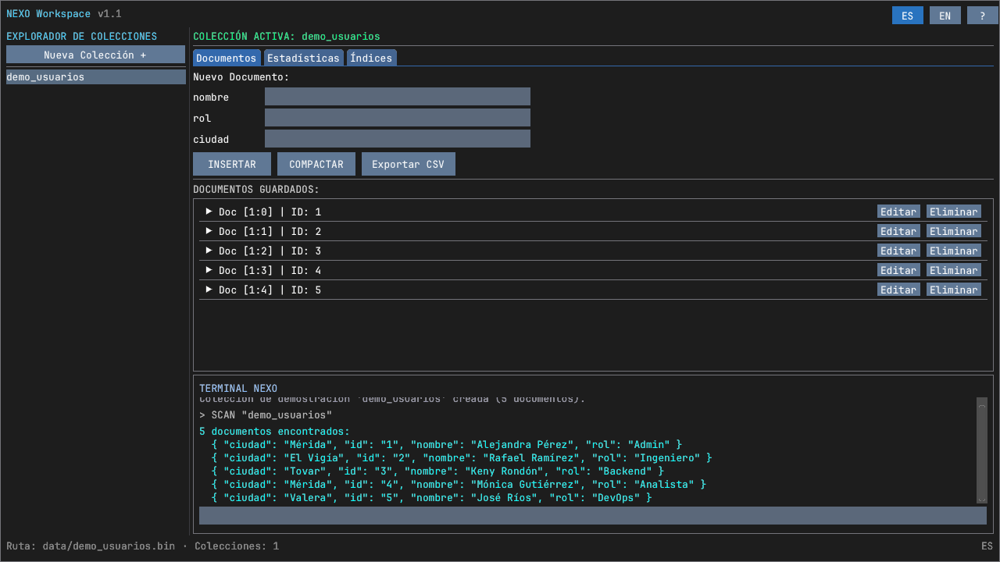
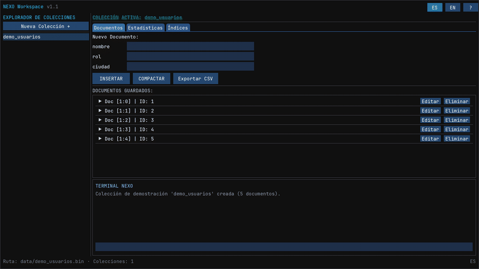

# NEXO Engine

[English](README.md) · **Español**

[](https://github.com/kenyosiosi/NEXO/actions/workflows/ci.yml)


Un **Sistema de Gestión de Bases de Datos (DBMS) no relacional desarrollado desde cero en C++17**, con motor de almacenamiento basado en páginas, indexación mediante Árboles B, un lenguaje de consultas NoSQL con tokenizer y parser propios, y una interfaz gráfica de escritorio interactiva.

> Proyecto universitario (Universidad de Los Andes, Programación 3) — reconstruido, endurecido y publicado con sistema de build moderno, suite de tests y CI.





## Características

- **Motor de almacenamiento** — Heap Files organizados en páginas de 4096 bytes con slots, borrado lógico (tombstones) y **auto-compactación** que recupera físicamente el espacio de los registros muertos.
- **Indexación con Árboles B** — Árboles B persistentes con **grado mínimo paramétrico** (2–27, limitado por el tamaño de página), serializados alineados a página. Los índices secundarios se construyen sobre los datos existentes a demanda.
- **Lenguaje de consultas** — tokenizer → parser descendente recursivo → AST → executor. Comandos: `CREATE`, `DEFINE`, `INSERT`, `GET`, `UPDATE`, `DELETE`, `SCAN`, `INDEX`, `STATS`, `DROP`, `COMPACT`.
- **GUI de trabajo** — una pestaña por colección: **Documentos** (insertar, editar y eliminar en el sitio), **Estadísticas** (páginas, slots, registros vivos/muertos, barra de fragmentación, tamaño en disco, recalculado cada frame) e **Índices** (lista cada Árbol B con su grado, crea y elimina índices secundarios con un clic). Incluye terminal con historial, guía integrada y **cambio ES/EN**.
- **Exportación CSV** — un clic escribe `data/<coleccion>.csv` (comillas RFC 4180, UTF-8 con BOM para que Excel muestre bien los acentos) solo con los registros vivos.
- **Contadores a prueba de cortes** — las secuencias de esquemas y el estado de asignación de páginas se persisten en cada escritura: reabrir una colección nunca corrompe sus índices.
- **E/S endurecida** — el serializador y la capa de almacenamiento validan cada longitud, offset y puntero antes de tocar memoria; los archivos corruptos degradan con elegancia en vez de crashear.
- **Bilingüe por diseño** — los mensajes del motor (`Core/Messages`) y las etiquetas de la UI (`ui/GuiStrings`) viven en dos catálogos ES/EN gobernados por un único interruptor de idioma.

## Descarga

Descarga un build de Windows autocontenido (sin instalador ni DLLs — un solo exe de ~5 MB) desde la
[**página de Releases**](https://github.com/kenyosiosi/NEXO/releases): baja `NexoEngine-vX.Y.Z-windows-x64.zip`, descomprime y ejecuta `NexoEngine.exe`.

## Compilar desde el código fuente

CMake ≥ 3.24 descarga automáticamente todas las dependencias (SFML 3, Dear ImGui, ImGui-SFML) en la primera configuración — no hay que preparar nada a mano.

### Windows (MSYS2 UCRT64 + Ninja)

```powershell
.\build.ps1          # configura + compila
.\build.ps1 -Test    # ... y corre la suite de tests
.\build.ps1 -Run     # ... y lanza la app
```

Requisitos: [MSYS2](https://www.msys2.org/) con `pacman -S mingw-w64-ucrt-x86_64-gcc mingw-w64-ucrt-x86_64-ninja`, más CMake.

### Linux / WSL

```bash
./build.sh           # configura + compila
./build.sh --test    # ... y corre la suite de tests
./build.sh --run     # ... y lanza la app
```

Requisitos: `cmake ninja-build` y los headers dev que SFML necesita
(`libgl1-mesa-dev libx11-dev libxrandr-dev libxcursor-dev libxi-dev libudev-dev libfreetype-dev`).

El binario queda en `build/NexoEngine.exe` (Windows) o `build-linux/NexoEngine` (Linux); ejecútalo desde ese directorio para que encuentre `assets/` y `data/`.

## Tests

`nexo_tests` cubre el motor de forma headless con [doctest](https://github.com/doctest/doctest) — 45 casos de prueba / 1540 aserciones en cinco archivos:

| Archivo | Cubre |
|---|---|
| `tests/test_storage.cpp` | Round-trips del serializador, buffers truncados/mentirosos, desborde de páginas, tombstones, persistencia, rechazo de registros gigantes, stats sin índice |
| `tests/test_btree.cpp` | Inserciones ordenadas/desordenadas/duplicadas, grado paramétrico, consistencia al reabrir tras splits |
| `tests/test_query.cpp` | ASTs del tokenizer/parser y flujos end-to-end CREATE→INSERT→GET→UPDATE→DELETE→DROP |
| `tests/test_messages.cpp` | Catálogos ES/EN, interpolación `{n}`, argumentos faltantes |
| `tests/test_export.cpp` | Escape CSV (comas, comillas, saltos de línea), orden de cabecera, campos y colecciones vacías |

```bash
ctest --test-dir build --output-on-failure
```

El CI compila y testea cada push en Linux (GCC) y Windows (MinGW-w64 UCRT64).

## Arquitectura

```text
┌─────────────────────────────────────────────┐
│  UI (src/main.cpp)                          │  Dear ImGui + SFML 3
├─────────────────────────────────────────────┤
│  Query Engine (src/Query_engine/)           │  tokenizer → parser → executor
├─────────────────────────────────────────────┤
│  Storage (src/Storage/)   │  B-Tree         │  HeapFile · Serializer · SchemaManager
└─────────────────────────────────────────────┘
        data/*.bin            data/*.idx
```

- `nexo_core` — la librería del motor (sin GUI, la parte que ejercitan los tests).
- `NexoEngine` — la capa de UI por encima.
- `nexo_tests` — la suite doctest.

Layout de datos: `<coleccion>.bin` (heap file), `<coleccion>.schema` (siguiente id + campos), `<coleccion>_<campo>.idx` (páginas del Árbol B), `<coleccion>.csv` (exportación).

## Cómo usar la interfaz

| Dónde | Qué puedes hacer |
|---|---|
| Pestaña **Documentos** | Rellena el formulario y pulsa **Insertar**; **Editar**/**Eliminar** en cualquier fila (la edición conserva el id, el borrado es lógico y pide confirmación); **Compactar** reescribe el archivo sin registros muertos; **Exportar CSV** vuelca los registros vivos |
| Pestaña **Estadísticas** | Páginas, slots totales, registros vivos/muertos, barra de fragmentación y tamaño en disco — recalculados desde las cabeceras de página en cada frame |
| Pestaña **Índices** | Cada Árbol B con su grado actual; elimina cualquier índice salvo el estructural `id`, o crea uno sobre un campo desde el combo |
| **Terminal** | Cualquier comando de la lista de arriba; `↑`/`↓` recorren el historial, `HELP` imprime la referencia, `CLEAR` limpia el log |
| **`?` / `ES`·`EN`** | Guía integrada (primeros pasos, comandos con botón *Probar*, atajos) y un interruptor de idioma que también cambia los mensajes del motor |

## Ejemplo de sesión

```text
CREATE "usuarios" {fields: "nombre,edad"}
INSERT INTO "usuarios" {"nombre": "Keny", "edad": "21"}
INDEX "nombre" ON "usuarios"
GET FROM "usuarios" {"nombre": "Keny"}
UPDATE "usuarios" SET {"edad": "22"} WHERE {"id": "1"}
SCAN "usuarios"
STATS "usuarios"
```

## Autores

- **Rafael Angel Ramirez Ibarra** — [Rafael-A69](https://github.com/Rafael-A69)
- **Rafael Andres Castillo Ortega** — [Chinoto03](https://github.com/Chinoto03)
- **Keny Joan Rondon Perez** — [kenyosiosi](https://github.com/kenyosiosi)

Universidad de Los Andes · Facultad de Ingeniería · Programación 3 · Prof. Alejandro Mujica

## Licencia

[MIT](LICENSE) · La fuente [JetBrains Mono](assets/fonts/OFL.txt) incluida está bajo la licencia SIL Open Font License.
