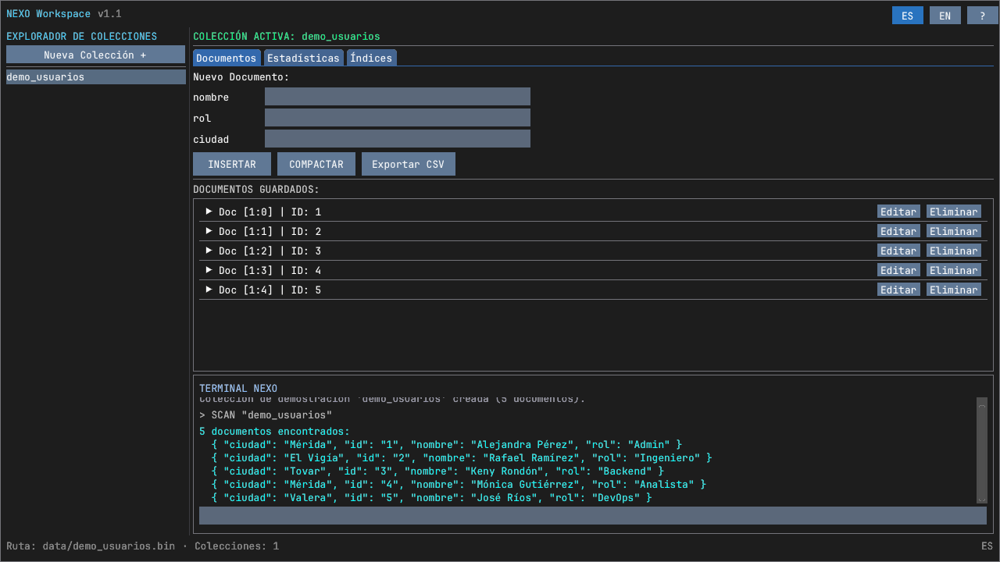
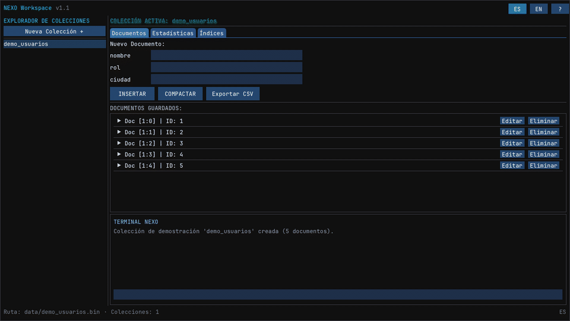

# NEXO Engine

**English** · [Español](README.es.md)

[](https://github.com/kenyosiosi/NEXO/actions/workflows/ci.yml)


A **non-relational DBMS built from scratch in C++17**, with a page-based storage engine, B-Tree indexing, a NoSQL query language with its own tokenizer/parser, and an interactive desktop GUI.

> University project (Universidad de Los Andes, Programación 3) — rebuilt, hardened and shipped with a modern build system, test suite and CI.





## Features

- **Storage engine** — Heap Files organized in 4096-byte pages with slotted pages, logical deletes (tombstones) and **auto-compact** that physically reclaims dead records.
- **B-Tree indexing** — persistent B-Trees with a **parametric minimum degree** (2–27, bounded by page size), stored page-aligned on disk. Secondary indexes are built over existing data on demand.
- **Query language** — tokenizer → recursive-descent parser → AST → executor. Commands: `CREATE`, `DEFINE`, `INSERT`, `GET`, `UPDATE`, `DELETE`, `SCAN`, `INDEX`, `STATS`, `DROP`, `COMPACT`.
- **Workspace GUI** — one tab per collection: **Documents** (insert, edit and delete in place), **Statistics** (pages, slots, live/dead records, fragmentation bar, file size, refreshed every frame) and **Indexes** (list every B-Tree with its degree, create and drop secondary indexes with one click). Plus a terminal with command history, an in-app guide and **ES/EN toggle**.
- **CSV export** — one click writes `data/<collection>.csv` (RFC 4180 quoting, UTF-8 with BOM so Excel shows accents) with the live records only.
- **Crash-safe counters** — schema sequences and page allocation state are persisted on every write, so reopening a collection never corrupts its indexes.
- **Hardened I/O** — the serializer and storage layers validate every length, offset and pointer before touching memory; corrupted files degrade gracefully instead of crashing.
- **Bilingual by design** — engine messages (`Core/Messages`) and UI labels (`ui/GuiStrings`) live in two ES/EN catalogs driven by a single language switch.

## Download

Grab a self-contained Windows build (no installer, no DLLs — a single ~5 MB exe with the UI font embedded) from the
[**Releases page**](https://github.com/kenyosiosi/NEXO/releases): download `NexoEngine-vX.Y.Z-windows-x64.zip`, unzip, run `NexoEngine.exe`.

## Build from source

CMake ≥ 3.24 fetches all dependencies automatically (SFML 3, Dear ImGui, ImGui-SFML) on the first configure — no manual setup needed.

### Windows (MSYS2 UCRT64 + Ninja)

```powershell
.\build.ps1          # configure + compile
.\build.ps1 -Test    # ... and run the test suite
.\build.ps1 -Run     # ... and launch the app
```

Requirements: [MSYS2](https://www.msys2.org/) with `pacman -S mingw-w64-ucrt-x86_64-gcc mingw-w64-ucrt-x86_64-ninja`, plus CMake.

### Linux / WSL

```bash
./build.sh           # configure + compile
./build.sh --test    # ... and run the test suite
./build.sh --run     # ... and launch the app
```

Requirements: `cmake ninja-build` and the dev headers SFML needs
(`libgl1-mesa-dev libx11-dev libxrandr-dev libxcursor-dev libxi-dev libudev-dev libfreetype-dev`).

The binary is written to `build/NexoEngine.exe` (Windows) or `build-linux/NexoEngine` (Linux); run it from that directory so it can find `assets/` and `data/`. On Windows the UI font is compiled into the executable, so the build looks the same even when copied elsewhere without `assets/`.

## Tests

`nexo_tests` covers the engine headlessly with [doctest](https://github.com/doctest/doctest) — 45 test cases / 1540 assertions across five files:

| File | Covers |
|---|---|
| `tests/test_storage.cpp` | Serializer round-trips, truncated/lying buffers, page overflow, tombstones, persistence, oversized-record rejection, index-free stats |
| `tests/test_btree.cpp` | Ordered/unordered/duplicate insertions, parametric degree, reopen consistency across splits |
| `tests/test_query.cpp` | Tokenizer/parser ASTs and end-to-end CREATE→INSERT→GET→UPDATE→DELETE→DROP flows |
| `tests/test_messages.cpp` | ES/EN catalogs, `{n}` interpolation, missing arguments |
| `tests/test_export.cpp` | CSV escaping (commas, quotes, line breaks), header order, empty fields and collections |

```bash
ctest --test-dir build --output-on-failure
```

CI builds and tests every push on both Linux (GCC) and Windows (MinGW-w64 UCRT64).

## Architecture

```text
┌─────────────────────────────────────────────┐
│  UI (src/main.cpp)                          │  Dear ImGui + SFML 3
├─────────────────────────────────────────────┤
│  Query Engine (src/Query_engine/)           │  tokenizer → parser → executor
├─────────────────────────────────────────────┤
│  Storage (src/Storage/)   │  B-Tree         │  HeapFile · Serializer · SchemaManager
└─────────────────────────────────────────────┘
        data/*.bin            data/*.idx
```

- `nexo_core` — the engine library (GUI-free, the part the tests exercise).
- `NexoEngine` — the UI layer on top.
- `nexo_tests` — the doctest suite.

Data layout: `<collection>.bin` (heap file), `<collection>.schema` (next id + field list), `<collection>_<field>.idx` (B-Tree pages), `<collection>.csv` (export).

## Using the workspace

| Where | What you can do |
|---|---|
| **Documents** tab | Fill the form and press **Insert**; **Edit**/**Delete** on any row (edit keeps the id, delete is a tombstone with confirmation); **Compact** rewrites the file without dead records; **Export CSV** dumps the live records |
| **Statistics** tab | Pages, total slots, live/dead records, fragmentation bar and on-disk size — recomputed from the page headers every frame |
| **Indexes** tab | Every B-Tree with its current degree; drop any index except the structural `id`, or create one over a field from the combo |
| **Terminal** | Any command from the list above; `↑`/`↓` walk the history, `HELP` prints the command reference, `CLEAR` empties the log |
| **`?` / `ES`·`EN`** | In-app guide (getting started, commands with a *Try* button, shortcuts) and a language switch that also flips engine messages |

## Example session

```text
CREATE "usuarios" {fields: "nombre,edad"}
INSERT INTO "usuarios" {"nombre": "Keny", "edad": "21"}
INDEX "nombre" ON "usuarios"
GET FROM "usuarios" {"nombre": "Keny"}
UPDATE "usuarios" SET {"edad": "22"} WHERE {"id": "1"}
SCAN "usuarios"
STATS "usuarios"
```

## Authors

- **Rafael Angel Ramirez Ibarra** — [Rafael-A69](https://github.com/Rafael-A69)
- **Rafael Andres Castillo Ortega** — [Chinoto03](https://github.com/Chinoto03)
- **Keny Joan Rondon Perez** — [kenyosiosi](https://github.com/kenyosiosi)

Universidad de Los Andes · Facultad de Ingeniería · Programación 3 · Prof. Alejandro Mujica

## License

[MIT](LICENSE) · The bundled [JetBrains Mono](assets/fonts/OFL.txt) font is under the SIL Open Font License.
